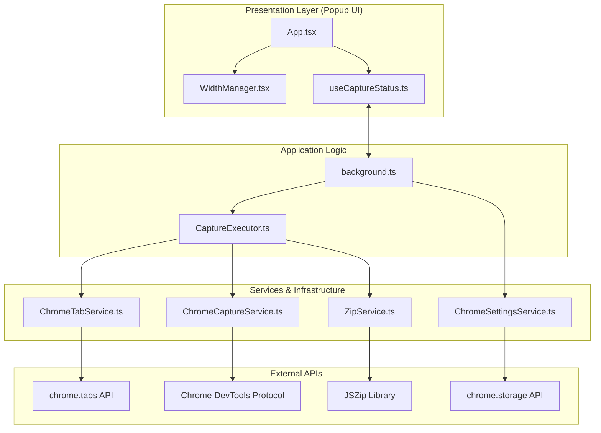

# 設計書 (ARCHITECTURE)

## システム構成図

## ディレクトリ構造と役割

- `src/components/`: 再利用可能な UI コンポーネント。
- `src/hooks/`: UI 状態管理と Background プロセスとの通信を抽象化するフック。
- `src/services/`: 外部 API (Chrome, CDP, JSZip) の詳細を隠蔽し、ドメインインターフェースを実装する具体クラス。
- `src/types/`: アプリケーション全体で使用される型定義とリポジトリインターフェース。
- `src/utils/`: 純粋関数（命名規則、バリデーション）の集まり。
- `src/background.ts`: 拡張機能のライフサイクル管理、状態の保持、メインプロセスの制御。

## 主要なシーケンス：キャプチャフロー

1.  **開始**: ユーザーが UI でボタンをクリック -> `useCaptureStatus` が `background.ts` にメッセージを送信。
2.  **準備**: `background.ts` が `CaptureExecutor` を初期化し実行。
3.  **ループ**: 各解像度について以下の処理を繰り返す：
    -   `TabService.resizeWindow`: ウィンドウサイズをターゲット幅に合わせて調整。
    -   `TabService.reloadTab`: メディアクエリやレイアウトを確定させるためにページをリロード。
    -   `CaptureExecutor.preScroll`: 遅延読み込み要素を表示させるため、ページ末尾までスクロール。
    -   `CaptureService.captureFullPage`: CDP の `Page.captureScreenshot` を使用し、ページ全体のクリッピング画像を取得。
    -   `ZipService.addFile`: 取得したデータをメモリ上の ZIP に追加。
4.  **完了**: `ZipService.generateZip` でアーカイブを生成し、`chrome.downloads` でブラウザに保存を指示。

## データモデル

### CaptureSettings

ユーザー設定（`chrome.storage.local` に保存）。
- `availableWidths`: 選択肢として表示する幅。
- `selectedWidths`: 撮影対象として選択されている幅。
- `imageFormat`: `jpeg` | `png`
- `quality`: 0.0 ~ 1.0

### CaptureStatus (Discriminated Union)

撮影の進行状態。UI の表示切り替えに使用。
- `IDLE`: 待機中。
- `PROCESSING`: 撮影中（現在の幅、進捗率を保持）。
- `ZIPPING`: ZIP 生成中（進捗率を保持）。
- `SUCCESS`: 完了。
- `ERROR`: エラー発生（エラーメッセージを保持）。
